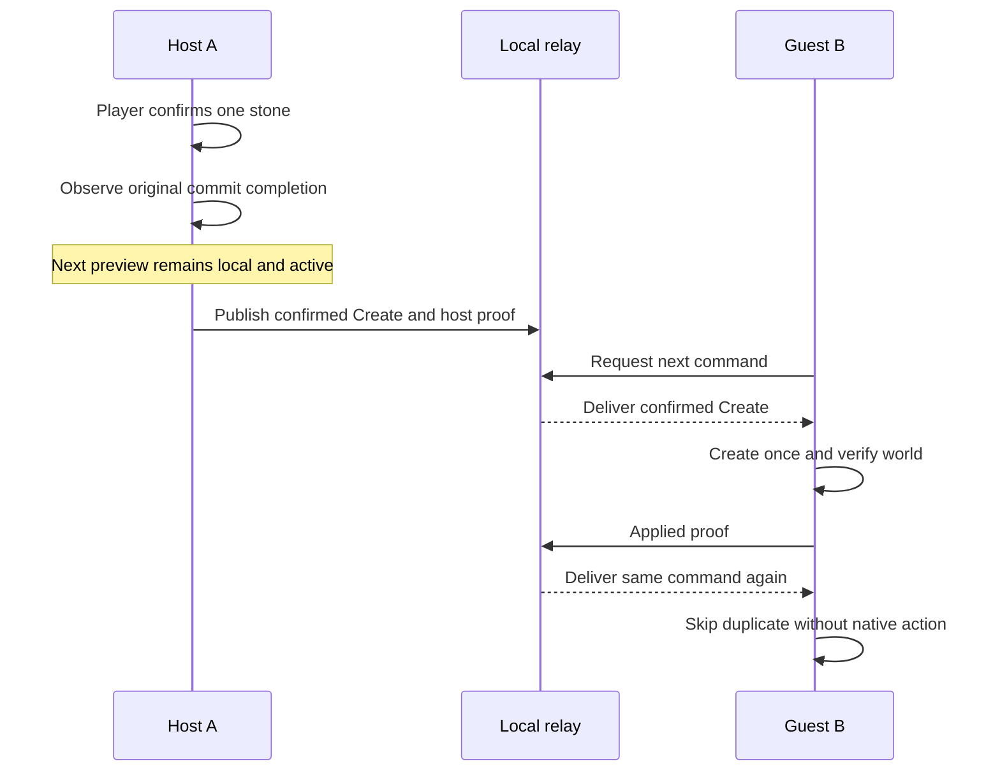
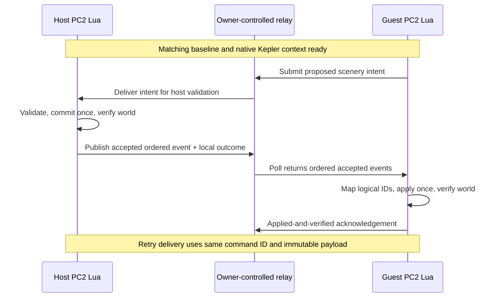

# Proposed HTTP scenery synchronization

**Full architecture remains proposed; scripted two-client and single manual host-Create paths verified. Updated 2026-10-23 through 082.** [Latest ledger](../research/DIAGNOSTICS_069_082.md) · [Latency investigation](HTTP_LATENCY_080_082.md) · [Transport facts](TRANSPORT.md) · [Latest evidence](../research/DIAGNOSTICS_050_068.md) · [Recovery](RECOVERY_AND_HISTORY.md) · [Measurements](BENCHMARKS.md)

## Scope and evidence boundary

Initial target: two players collaboratively create, move and delete supported scenery in matching parks. Exchange **accepted object changes**, not the entire park every poll. Existing thousands of unchanged objects require identity/baseline agreement, not continuous retransmission of their transforms. Full guests/staff/economy/terrain/ride simulation is outside this design; matching scenery does not imply deterministic simulation.

Two simultaneous local clients now pass scripted Create/Move/Delete/native Undo/Redo, duplicate handling, controlled ACK/TCP/server restart and completed-checkpoint Guest reload (071–078). Corrected 079–081 capture one ordinary player-confirmed host rock and create it once on the guest; 080/081 keep the distinct next host preview local and active. These are narrow diagnostic paths. General manual Move/Delete, guest intent/ownership, remote HTTPS, automatic general durable recovery, lobby integration and resync remain unverified.

## Verified one-way manual Create path — 080/081

This diagram describes the tested flow, including its extra diagnostic proof gate. A's originating commit is not replayed locally. B does not publish remote effects back. That one-way configuration does not yet establish general bidirectional capture/echo suppression. Only sampled preview continuity is claimed. The target product should transfer confirmed placements while the next preview remains active; transient previews are not durable Create events.

## Proposed complete roles and data path

This is a proposed host-authoritative edit model. The relay coordinates durable delivery and ordering; it cannot decide whether a PC2 preview is actually committable. Define one accepted event sequence at the host and have the relay retain it. A guest proposes intent and waits for acceptance before a durable local effect in the first prototype. A host's already committed originating edit must be recorded as locally applied when its event is echoed, preventing a second local commit.

Single ordinary host Create observation is verified in corrected 079–081. General Move/Delete interception, repeated/cancelled placement and guest-originating intent acceptance are not. The complete diagram above remains proposed. If normal UI already committed an edit, record it as locally applied; do not automatically replay its echoed event on the origin.

## Proposed event envelope

| Field | Purpose |
| --- | --- |
| protocolVersion / operationSchema | Reject incompatible wire interpretation |
| sessionID / sessionEpoch | Isolate parks and invalidate stale runs after reset |
| baselineID / baselineDigest | Ensure peers refer to the same starting world and identity manifest |
| commandID | Immutable unique ID, stable across retransmission |
| acceptedSequence | One authoritative order; local arrival order is not authority |
| originClientID | Track origin and avoid applying an already committed origin effect again |
| objectKey | Mod-owned identity; never transmit a local Part-ID as universal identity |
| operation / resourceKey / worldTransform | Allowlisted CREATE/MOVE/DELETE plus explicit validated data |
| expectedObjectRevision | Reject concurrent/stale edits to the same object |
| canonicalPayloadDigest | Detect conflicting reuse of an ID; define canonical bytes/version first |
| transactionID, if batching | Explicitly distinguish an event group from independent commands |

This schema is a proposal, not a claim that JSON, digest libraries or all transform fields have already been tested in this Lua environment. Existing diagnostics use a small text protocol, tested rock positions and limited captured/prepared orientation checks; full world rotation/scale equivalence across resources is not established. A digest is not authentication.

## Admission, execution and acknowledgement

1. Validate destination session/epoch, baseline, protocol, sender permissions, input bounds and allowlisted resources. Reject non-finite coordinates, unknown operations, excessive body/group sizes and malformed fields. Never execute received Lua/source text.
2. Check commandID against a canonical immutable payload BEFORE effects. Same ID/same content is a duplicate; same ID/different content is a conflict. For a sequence gap, stop at the gap and request the missing event. Existing tests reject out-of-order inputs; a production missing-event buffer/replay service is not yet implemented.
3. Resolve objectKey to the current client's local Part-ID. Look up current Entity-ID when needed; do not persist transient Entity-IDs as identity. Deletion leaves a logical tombstone. CREATE allocates a separate local placement on each peer.
4. Execute one owned editor transaction at a time, with expected revision checked before execution. Keep an in-flight command reservation before native calls, never start a parallel retry while the outcome is unresolved.
5. Wait for entity/preview completion, require CanCommitPreview, reserve the commit attempt BEFORE calling CommitPreview, then wait for the operation and undo-idle state. Verify resource and world transform/mappings over later Advances.
6. Only then acknowledge APPLIED_AND_VERIFIED. HTTP 200 / received / queued is NOT an application acknowledgement. On a completed duplicate return the stored outcome without another editor operation.
7. On uncertainty after commit attempt, pause replication for that operation. Do not guess failure from a disconnected response and blindly commit again.

In-memory deduplication survives the tested network/server failures while the client remains alive (059–062). A controlled completed-checkpoint reload restores the corresponding records in 063; 078 extends this to B restarting while A/server stay alive. Automatic arbitrary-crash-safe deduplication is not established. It provides **at-most-once commit attempts in the tested lifetime**, not distributed exactly-once effects under crashes.

## Crash and reconnect boundaries

There is no demonstrated atomic transaction joining a PC2 park commit, the relay journal and mod-owned persistent metadata. A crash after native commit but before recording/acknowledging it is an ambiguous outcome. A server remembering a commandID alone cannot resolve whether a restarted client already applied it.

Proposed recovery requires a durable accepted-event journal, client applied watermark, object revision/tombstones, save/baseline identity and an independently verified inventory reconciliation. Persist the logical identity manifest with a defined matching park checkpoint; a controlled manifest pairing passed in 063 and the two-client extension 078, while automatic in-save mod-data integration is still unproven. Reconnect resumes only after epoch/baseline/watermark agreement. On mismatch, stop edits and reconcile or load an agreed checkpoint; do not replay all CREATEs into an unknown park.

Late join should use a known compatible baseline/checkpoint plus subsequent ordered changes, not an unbounded initial event history. Test chunked inventories and repair procedures separately. Saving is a host-controlled explicit checkpoint decision, not a side effect of receiving each event. 063 and 078 establish controlled completed-checkpoint workflows, not this general distributed metadata/resync workflow.

## HTTP polling, batching and backpressure

Begin with one request in flight per client, bounded event batches and an ordered editor queue. Poll with an applied sequence/cursor; retain undelivered events until the intended consumer acknowledges application. Use timeout/backoff and queue limits, not an infinite tight retry loop. Idle polling frequency and batch budgets must be measured on the actual remote route.

HTTP can carry ordered operations reliably at the transport layer, but reconnects and retries still require application dedup/order/recovery. No request-response protocol makes a game commit atomic. Request delivery latency includes network RTT, poll waiting, native task scheduling, admission and the editor operation. Separate native commit completion, world verification and confirmation returned to the host: 081 measured about 16.25 ms for B's commit call/wait but 2239.214 ms until A received the application proof.

Diagnostics 048/049 support batching **independent creates**: issue multiple requests with a shared completion token, wait once, edit each result, preview and commit once. Do not merge dependent CREATE/MOVE/DELETE events or unrelated user undo actions into a batch without explicit transaction semantics. One commit for many objects changes the undo boundary and failure handling. 050–054 passed 500-rock groups / 2,701 total rocks; 067/068 profiled real objects and targeted checks. These observations are not a universal frame budget. Large batches and repeated full inventories must remain bounded by measured work and transaction semantics.

Completed 082 exposes a native-request-path delay: B later takes about 940 ms inside RunKeplerRequest even alone, with larger backlog and separate ports, while server processing/write and Guest Python controls are fast. A possible pacing/limiting mechanism is a hypothesis, not an established quota. Do not just raise polling frequency or blame HTTP globally. Test request spacing/history/recovery and pre-connect versus post-response timing. [Full method and phase table](HTTP_LATENCY_080_082.md).

The 080/081 relay withheld B delivery until A submitted a second diagnostic proof after publication. Removing this extra delivery gate and moving additional audits off the critical path are candidates to test while preserving native completion, valid world data and immutable command status. Long polling, persistent connections and a sidecar also remain untested alternatives.

Use measurements to choose batch size/frame budget. A localhost 1 MiB response test is not a target packet size and does not establish upload throughput, multi-peer capacity or safe edit rates.

## Internet deployment proposal

Each client connects outward to an owner-controlled HTTPS relay; friends need not share a LAN and ordinarily do not need inbound game-port forwarding in this design. This is untested deployment design. The current runtime evidence is loopback plain HTTP; test native remote HTTPS, certificates, headers, timeouts and reconnect before promising a friend-ready internet mod.

038 used an in-memory diagnostic relay; later 062/063 servers added limited checkpoint journals for their specific recovery tests. None is a production service with complete security/durability guarantees. Do not expose that server unchanged. A public relay needs its own session authentication, authorization, bounded requests, replay/epoch checks, request-rate limits, retention and TLS. `SetGenerateAuthCode(false)` avoids requesting Frontier-generated auth for our endpoint; it does not authenticate our own relay. Production submission should use a defined mutation method/body and avoid sensitive query-string logging. POST/headers/upload support still need an explicit native-API test; successful GET diagnostics do not prove those capabilities.

The relay could be a separate service, or a local sidecar that maintains the remote link while the game uses loopback HTTP. A sidecar is an architectural option, not a tested shipped bridge. It would preserve our validated local HTTP boundary while moving remote security/recovery into original external code.

## Staged acceptance tests and current position

1. Two simultaneous clients: harmless numbered messages both ways, matched session and full task completion.
2. Owner-controlled remote HTTPS route: same test, with explicit latency and timeout evidence.
3. Scripted host CREATE followed by guest application: same logical key, separate local Part-IDs, same resource/world transform, one commit per intended peer.
4. Duplicate/lost response, delayed sequence, conflicting ID and stale revision: no extra game effects; application acks and recovery state recorded.
5. MOVE/DELETE plus independent objects; no origin echo; preview cancellation and local edit ownership.
6. Confirmed ordinary UI edit capture; then persistent mappings, checkpoint/reload, crash/reconnect and late join.
7. Load/soak tests with realistic parks and frame-time measurement, followed by supported resource/undo/transform expansion.

Current position: local parts of gates 1, 3–5 and one host-Create part of gate 6 passed in controlled diagnostics. The remote route, general guest/manual edits, ownership, automatic durable recovery and resync remain open. 082 adds a concrete request-latency investigation before choosing a production polling budget. No playable release or complete park synchronization is claimed.

## Registry and Undo decisions informed by 064–068

Use the engine's current placement queries with a small logical-key/Part-ID/revision registry. Keep expected-world snapshots used by diagnostics separate from required production state. At 2,701 real rocks the tested query bundles stayed inexpensive; full inventories cost proportionally more and were spread over Advances. 066's 100,000-record test is synthetic, not park capacity evidence.

064 lost native Undo/Redo after the tested reload, although saving alone preserved it. Shared/cross-session history must not depend on identical native stacks. 065's Move counteractions are optional history operations with new IDs, authoritative ordering and expected revision checks; they are not engine-stack reconstruction. Automatic action-data persistence and general Create/Delete counteractions remain open.

066's pruning model rejects old sequences below a checkpoint boundary after removing exact payload records. Production compaction must prove a durable checkpoint and safe retention for all consumers, tombstones and recovery paths before removing evidence. See [recovery/history](RECOVERY_AND_HISTORY.md).
